# Brief — Automatiser sa recherche d'emploi Data Analyst avec Make (version JSearch)

Brief Data Analyst d'une journée (7 h), individuel et guidé : l'apprenant apprend d'abord Make avec les tutos 1 et 2, puis construit seul un scénario qui récupère chaque semaine les offres « data analyst » (stages, alternances, CDI) grâce à l'API JSearch, les range dans un Google Sheet de suivi de candidatures et envoie une alerte sur Discord. Le tuto 3 (version JSearch) sert de corrigé et n'est remis qu'après le rendu.

## Fiche Simplonline

**Titre** : Automatiser sa recherche d'emploi Data Analyst avec Make et l'API JSearch

**Description rapide** : Chercher un stage, une alternance ou un emploi prend du temps : mêmes recherches, mêmes sites, chaque semaine. Dans ce brief, vous construisez avec Make un scénario no-code qui interroge l'API JSearch (les offres de Google pour l'emploi : Indeed, LinkedIn, Hellowork, Apec…), récupère les nouvelles offres de data analyst de votre ville, les range dans un Google Sheet de suivi de candidatures et vous prévient sur Discord. Vous commencez par vous former à Make avec deux tutos guidés, puis vous réalisez le projet en suivant des étapes et des captures d'écran, en particulier pour l'appel HTTP.

**Compétences visées** :

- **C6 — Collecter des données depuis différentes sources** — Ce qu'elle couvre ici : Appel d'une API protégée par une clé (header) avec le module HTTP de Make — Niveau : 2 — Adapter
- **C7 — Nettoyer et préparer les données** — Ce qu'elle couvre ici : Mise en forme des dates, valeurs manquantes, choix des champs utiles, liens cliquables — Niveau : 2 — Adapter
- **C8 — Stocker les données dans une structure adaptée** — Ce qu'elle couvre ici : Google Sheet de suivi structuré, alimenté automatiquement — Niveau : 2 — Adapter

Niveau 2 partout : les tutos 1 et 2 donnent un exemple complet (veille RSS) que l'apprenant adapte à une nouvelle source, une API, sans corrigé pendant le projet.

**Organisation :** individuel · 1 journée (7 h) de réalisation, puis une séance de restitution à part pour les démos · prérequis : aucun en programmation.

**À faire avant la journée (30 min) :** créer les quatre comptes gratuits du projet, chacun avec une validation par e-mail ou une connexion Google : **make.com** (« Get started free », inscription possible avec votre compte Google, région EU), **openwebninja.com** (inscription avec « Continue with Google », sans carte bancaire), **Discord** et **github.com** (GitHub peut demander d'activer la double authentification avec une application sur votre téléphone : prévoyez-le). Ainsi, la journée est consacrée au projet et non aux inscriptions.

## Contexte

Vous débutez votre formation de Data Analyst. Dans quelques mois, il faudra décrocher un stage pour la fin de la formation, ou une alternance. Autant s'y prendre dès maintenant : les entreprises recrutent souvent plusieurs mois à l'avance.

Chaque semaine, c'est le même rituel : ouvrir les sites d'offres, taper « data analyst », repérer les nouveautés, noter quelque part celles qui vous intéressent… et oublier à qui vous avez déjà écrit. Vous perdez du temps sur la recherche au lieu de soigner vos candidatures.

Le défi : **appliquer votre métier à votre propre recherche d'emploi**. Un data analyst sait aller chercher des données, les nettoyer et les ranger pour en tirer des décisions. Les offres d'emploi sont des données comme les autres.

Bonne nouvelle : le service **JSearch** (OpenWeb Ninja) donne accès, grâce à une **API**, aux offres que Google pour l'emploi rassemble depuis Indeed, LinkedIn, Hellowork, l'Apec, Welcome to the Jungle… Son offre gratuite permet 200 recherches par mois, sans carte bancaire. Pour construire votre outil, vous allez découvrir **Make**, un outil d'automatisation no-code, ainsi que **Google Sheets** et **Discord**.

Votre objectif : un outil qui, chaque lundi matin, sans aucune action de votre part :

- récupère les offres « data analyst » de votre ville publiées depuis une semaine (stages, alternances, CDI…) ;
- les range dans un tableau de suivi de candidatures, avec des colonnes que vous compléterez vous-même (statut, date de candidature, notes) ;
- vous envoie une alerte par offre dans un salon Discord privé, avec le lien pour postuler.

Contraintes : pas de budget (offres gratuites de Make et de JSearch), aucun mot de passe ni clé secrète visible dans vos livrables, et un outil qu'une personne qui ne l'a pas construit peut comprendre en lisant votre document de présentation.

Lors de la séance de restitution, vous présenterez votre automatisation en 5 minutes, avec un vrai tableau rempli d'offres réelles.

## Phase 0 — Apprendre Make avec les tutos 1 et 2 (2 h)

Avant le projet, vous apprenez Make en construisant une **veille data automatique** pas à pas. Suivez les deux tutos dans l'ordre, sans sauter d'étape : tout ce que vous y apprenez resservira dans le projet.

- **[Tuto 1 — Connecter Google Sheets à Make](https://github.com/gsoulat/brief-recherche-emploi-make/blob/main/ressources/tuto-1-connecter-google-sheets-a-make.pdf)** — Ce que vous apprenez : Créer une connexion (Credentials) entre Make et un service — Resservira dans le projet pour… : La connexion Google Sheets du module Add a Row
- **[Tuto 2 — Construire la veille RSS dans Make](https://github.com/gsoulat/brief-recherche-emploi-make/blob/main/ressources/tuto-2-construire-la-veille-rss-dans-make.pdf)** — Ce que vous apprenez : Créer un scénario, enchaîner des modules, Iterator, filtre, mapping vers Google Sheets, fonctions (`formatDate`, `ifempty`), Run once, planification — Resservira dans le projet pour… : Toute la chaîne : récupérer, boucler, nettoyer, stocker, planifier

**Point de contrôle :** votre scénario « Veille Data RSS » remplit le Google Sheet et il est planifié. Vous savez expliquer avec vos mots ce que sont un **module**, un **bundle**, un **Iterator** et un **mapping**.

> 💡 L'offre gratuite de Make autorise 2 scénarios actifs. Votre veille RSS peut rester active : le scénario du projet sera le deuxième.

> 💡 Le tuto 2 parle d'« opérations » : c'est la même chose que les « crédits » de ce brief (1 module exécuté = 1 crédit). Si un chiffre d'une capture (nombre d'articles, de bulles, de lignes) diffère du vôtre, c'est normal : il dépend des articles publiés le jour où vous faites le tuto.

**Petit glossaire**

- **API** : un service qui permet à un programme (ici Make) de demander des données à un site, sans passer par ses pages web.
- **Clé d'API** : un mot de passe propre à votre compte, que l'API demande à chaque appel. Chez JSearch, elle commence par `ak_`.
- **Header** : une étiquette jointe à la demande. C'est là qu'on glisse la clé (`x-api-key`).
- **JSON** : le format texte dans lequel une API répond, fait de paires « nom : valeur ». Make le découpe pour vous en pastilles.
- **Webhook** : une adresse secrète qui permet de poster un message dans un salon Discord.
- **Blueprint** : l'export de votre scénario Make dans un fichier .json, qui permet de le sauvegarder ou de le partager.

## Modalités pédagogiques

Travail **individuel**, sur une journée : la phase 0 le matin (2 h), puis le projet en 8 étapes. Chaque étape se termine par un point de contrôle : ne passez pas à la suivante tant qu'il n'est pas atteint. Bloqué plus de 10 minutes ? Demandez de l'aide à un voisin. Sauvegardez votre scénario souvent (`Ctrl+S` / `Cmd+S`).

- **0. Apprendre Make (tutos 1 et 2)** — Durée : 2 h — Point de contrôle : Veille RSS fonctionnelle
- **1. Obtenir sa clé d'API JSearch** — Durée : 20 min — Point de contrôle : JSearch actif (offre Basic), clé copiée dans un fichier privé
- **2. Préparer Discord** — Durée : 15 min — Point de contrôle : Salon créé, URL du webhook copiée
- **3. Concevoir le Sheet de suivi** — Durée : 15 min — Point de contrôle : En-têtes en ligne 1
- **4. Module HTTP (recherche des offres)** — Durée : 45 min — Point de contrôle : Test du module : des offres reçues (Status Code 200)
- **5. Iterator + Google Sheets** — Durée : 40 min — Point de contrôle : Une ligne par offre dans le Sheet
- **6. Alerte Discord** — Durée : 30 min — Point de contrôle : Une alerte par offre dans le salon
- **7. Tester, planifier, compter** — Durée : 20 min — Point de contrôle : Scénario planifié, crédits et requêtes estimés
- **8. Documenter et préparer la démo** — Durée : 40 min — Point de contrôle : dépôt GitHub prêt (document, blueprint, captures)
- **Bonus (si la première version fonctionne). Éviter les doublons** — Durée : 30 min — Point de contrôle : Un second Run once n'ajoute aucune ligne

**Étape 1 — Obtenir sa clé d'API JSearch**

1. Ouvrez **openwebninja.com/api/jsearch** et cliquez sur **« Start for free »**. Connectez-vous avec **« Continue with Google »**.
2. Sur la page **Overview**, cliquez sur **JSearch**, puis sur **« Start free »**.
3. Sous l'offre **Basic** (0 $, 200 requêtes par mois, limite stricte : aucune facturation possible), cliquez sur **« Start for free »**. JSearch doit apparaître comme **Active**.
4. Dans le menu de gauche, cliquez sur **Account**, puis sur **Copy** à côté de votre clé (`ak_…`). Collez-la dans un fichier texte privé, rangé hors de votre futur dépôt GitHub.

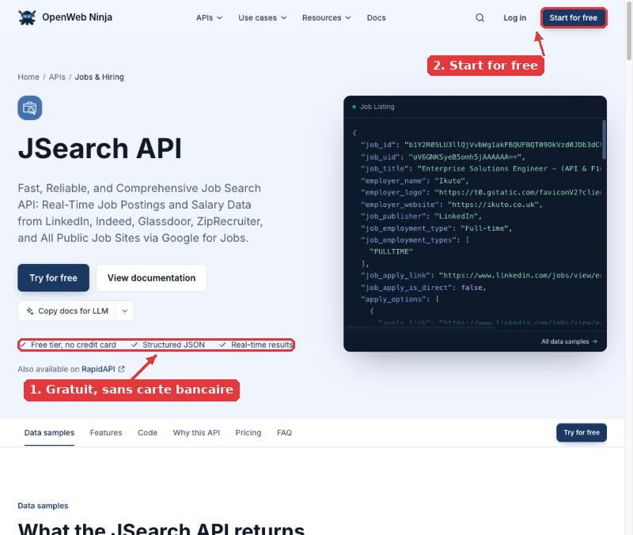

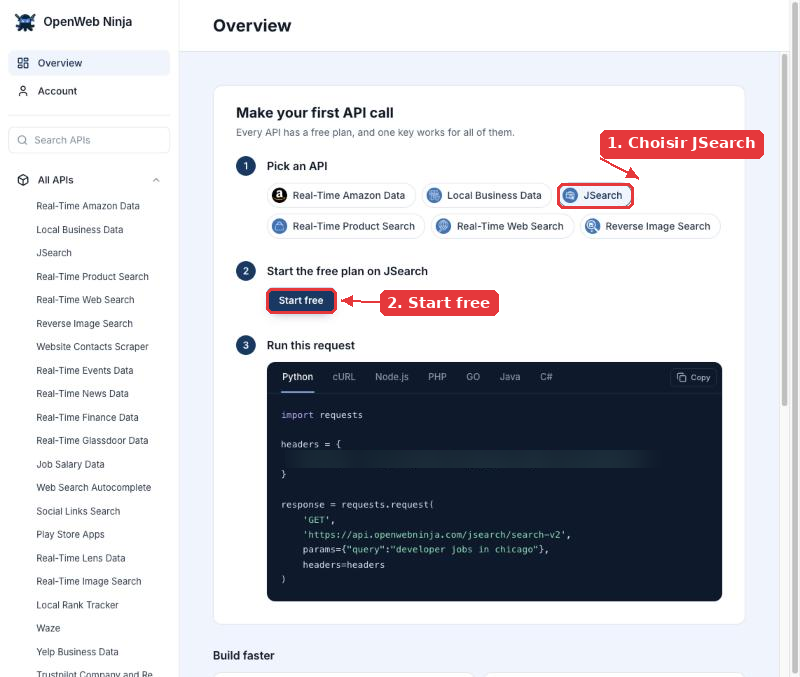

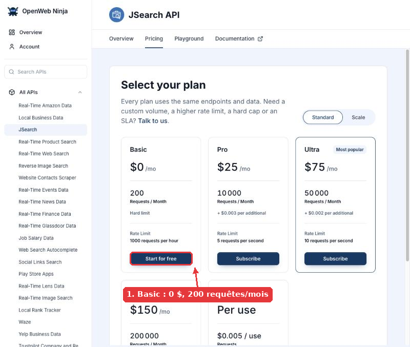

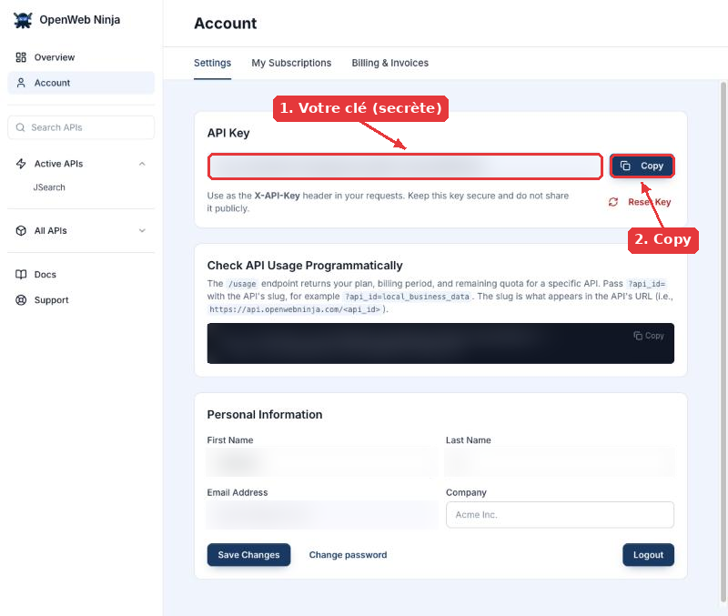

> 💡 L'onglet **Playground** de JSearch permet d'essayer une recherche avant Make. Chaque essai consomme une requête sur vos 200 du mois : n'en abusez pas.

Questions guidantes : pourquoi l'API demande-t-elle une clé à chaque appel ? Que risquez-vous si votre clé se retrouve sur GitHub ?

**Étape 2 — Préparer Discord**

1. Dans Discord, cliquez sur le **« + »** en bas de la liste des serveurs (à gauche), puis **Créer le mien** > **Pour moi et mes amis**, et nommez le serveur.
2. Créez un salon textuel `offres-data` (« + » à côté de « Salons textuels »).
3. Survolez le salon, cliquez sur la **roue dentée** (Modifier le salon) > **Intégrations** > **Webhooks** > **Nouveau webhook**, puis **Copier l'URL du webhook** et collez-la dans votre fichier privé.

Question guidante : un webhook est une « adresse postale » du salon. Pourquoi faut-il la garder secrète ?

**Étape 3 — Concevoir le Sheet de suivi**

Créez un Google Sheet `Suivi candidatures Data Analyst`. Il doit contenir au minimum : la date de publication, l'intitulé, l'entreprise, le lieu, le type de contrat, le site d'origine de l'offre et le lien pour postuler (remplis par Make), puis un statut, une date de candidature et des notes (remplis par vous).

- Placez les colonnes remplies par Make à gauche et vos trois colonnes de suivi **à droite**.
- Dès maintenant, sélectionnez la colonne de la date puis **Format > Nombre > Texte brut** : vos dates JJ/MM/AAAA s'afficheront telles quelles, sans inversion jour/mois.

Questions guidantes : à quoi sert la colonne « site d'origine » ? Quelles colonnes Make doit-il remplir, et lesquelles sont pour vous ?

**Étape 4 — Module HTTP** → suivez le **Zoom sur les modules HTTP** ci-dessous, pas à pas.

**Étape 5 — Iterator + Google Sheets**

> ⚠️ Ne commencez cette étape que si le module HTTP renvoie des offres. Si la liste `jobs` est vide, élargissez d'abord votre recherche (autre ville, `date_posted` à `month`, mots-clés plus larges) : sans offre, l'Iterator n'a aucun champ à vous proposer.

Comme dans le tuto 2 : un **Iterator** sur la liste des offres, puis **Google Sheets > Add a Row**.

1. **Iterator** : cliquez dans le champ **Array**. Dans le panneau des pastilles, sous **HTTP (module 1)**, dépliez **Data**, puis **data**, et cliquez sur **`jobs[]`**. Si le panneau est vide, testez d'abord le module HTTP : Make ne connaît les champs qu'après une première exécution.
2. **Add a Row** : choisissez votre Sheet et sa feuille. Les champs d'une offre apparaissent alors sous le module **Iterator** : `job_posted_at_datetime_utc`, `job_title`, `employer_name`, `job_location`, `job_employment_type`, `job_publisher` et `job_apply_link`. **Laissez vides** dans Make les champs statut, date de candidature et notes : c'est vous qui les remplirez.

Indices pour le nettoyage (remplacez « pastille » par la pastille du champ, en cliquant dessus) :

- Date au format JJ/MM/AAAA : `formatDate(pastille; "DD/MM/YYYY")`
- Valeur absente remplacée : `ifempty(pastille; "Non communiqué")`
- Lien de l'offre : le champ `job_apply_link` est déjà un lien complet, il suffit de le placer dans la bonne colonne.

Les fonctions se trouvent aussi dans les onglets du panneau des pastilles (icône calendrier pour les dates, icône engrenage pour `ifempty`). Les séparateurs sont des **points-virgules**.

Questions guidantes : pourquoi certaines offres n'ont-elles pas de nom d'entreprise ou de lieu ? Que se passerait-il dans votre Sheet sans `ifempty` ?

**Étape 6 — Alerte Discord** → voir le Zoom HTTP, partie « Dernier module ». En général, utilisez les pastilles du panneau plutôt que de taper des numéros de modules : les numéros changent si vous supprimez un module.

**Étape 7 — Tester, planifier, compter**

1. Lancez **Run once** et vérifiez le Sheet et le salon Discord.
2. Supprimez les lignes de test du Sheet (gardez la ligne d'en-têtes).
3. Planifiez et activez le scénario, comme à l'étape 7 du tuto 2 : en haut à droite, cliquez sur le réglage de planification (« Every 15 minutes » par défaut), choisissez **Weekly**, **Monday**, **08:00**, puis **Save**. Cliquez enfin sur **Save and activate** : le scénario doit apparaître comme **actif**.
4. Relevez le nombre de crédits Make consommés par une exécution (historique du scénario) et estimez la consommation sur un mois. Faites de même pour les requêtes JSearch (onglet **Requests** de JSearch).

Questions guidantes : pourquoi une exécution par semaine avec `date_posted = week` évite-t-elle la plupart des doublons ? Combien de recherches différentes (villes, contrats) pouvez-vous lancer chaque semaine avec 200 requêtes JSearch et 1 000 crédits Make par mois ?

> ⚠️ Le **Run once** de la démo ajoutera de nouveau les offres de la semaine. **Videz les lignes du Sheet (sauf les en-têtes) juste avant la démo**, pour éviter les doublons.

**Étape 8 — Documenter et préparer la démo**

1. **Document de présentation** : rédigez-le dans Word, ou dans Google Docs puis **Fichier > Télécharger > Microsoft Word (.docx)**, ou encore dans un simple fichier .txt, en suivant la liste de la partie *Livrables attendus*.
2. **Lien du Sheet en lecture seule** : dans Google Sheets, **Partager** > Accès général : **Tous les utilisateurs disposant du lien** > rôle **Lecteur** > **Copier le lien**, puis collez-le dans le document.
3. **Blueprint** : dans le scénario, menu **« … »** en haut à droite > **Export Blueprint**. Ouvrez le fichier .json avec un éditeur de texte (Bloc-notes sous Windows : clic droit > Ouvrir avec ; TextEdit sur Mac). Avec **Rechercher / Remplacer** (`Ctrl+H` sous Windows, `Cmd+Option+F` sur Mac), remplacez votre clé d'API et l'URL du webhook par `***`, puis enregistrez. Vérifiez avec **Rechercher** (`Ctrl+F` / `Cmd+F`) que `ak_` et `discord.com/api/webhooks` ne donnent plus aucun résultat.
4. **Captures** : prenez-les avec l'outil Capture d'écran (Windows : `Win+Maj+S` ; Mac : `Cmd+Maj+4`). Masquez chaque secret ou donnée personnelle par un rectangle plein (Paint, Aperçu…) ou recadrez l'image pour l'exclure.
5. **Dépôt GitHub** : sur github.com, cliquez sur **« + »** en haut à droite > **New repository**, nommez-le `recherche-emploi-make-<prénom>`, choisissez **Public**, cochez **Add a README file**, puis **Create repository**. Cliquez ensuite sur **Add file > Upload files**, glissez votre document, le blueprint et les captures (pas de fichier .zip), puis **Commit changes**. Vérifiez une dernière fois qu'aucun secret n'apparaît.
6. Préparez une démo de 5 minutes.

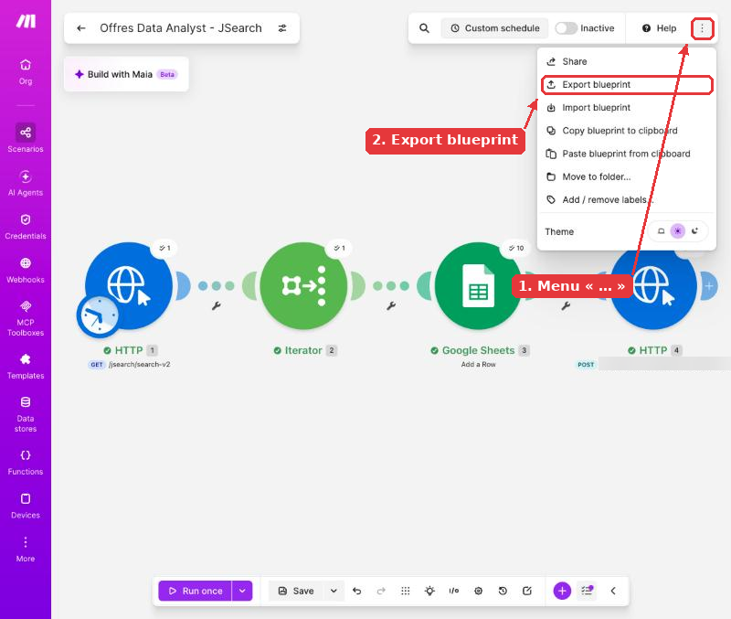

## Zoom sur les modules HTTP

Le module **HTTP > Make a request** est le plus délicat du projet : c'est lui qui « parle » directement à une API, sans assistant. Prenez le temps de lire cette partie avant de cliquer.

**Le principe, en une image.** Une API est un guichet. Pour y passer, on présente sa **clé** à chaque demande (dans un header), et on dit ce qu'on cherche (dans les paramètres de la demande). Le guichet répond avec la liste des offres.

La partie « En Python » est donnée à titre de comparaison, pour plus tard : vous n'avez pas besoin de la comprendre pour réussir le projet.

- **URL** — Ce que c'est : L'adresse du guichet — En Python : `url = "https://..."`
- **Method** — Ce que c'est : Le type de demande : GET demande des infos, POST en envoie — En Python : `requests.get(...)` / `requests.post(...)`
- **Header** — Ce que c'est : Une étiquette jointe à la demande, ici la clé — En Python : `headers={"x-api-key": cle}`
- **Query parameters** — Ce que c'est : Les critères de recherche, ajoutés à l'URL — En Python : `params={...}`
- **Body** — Ce que c'est : Ce qu'on envoie avec un POST (ici, le message Discord) — En Python : `data={...}`
- **Parse response** — Ce que c'est : Make découpe la réponse en champs utilisables — En Python : `r.json()`

### Ajouter un module HTTP

Cliquez sur **« + »**, choisissez **HTTP**, puis le module **« Make a request »**.

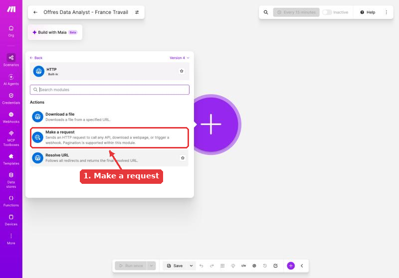

### Module 1 — Chercher les offres

- **Authentication type** : `No authentication` (la clé passe dans un header que vous ajoutez vous-même)
- **URL** : `https://api.openwebninja.com/jsearch/search-v2`
- **Method** : `GET`
- **Headers** : Name `x-api-key`, Value = votre clé (`ak_…`)
- **Parse response** : `Yes`

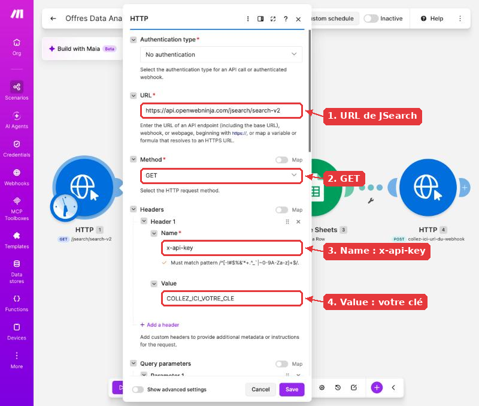

Cliquez sur **« + Add a header »**, tapez `x-api-key` dans **Name** et collez votre clé dans **Value**, sans espace avant ni après.

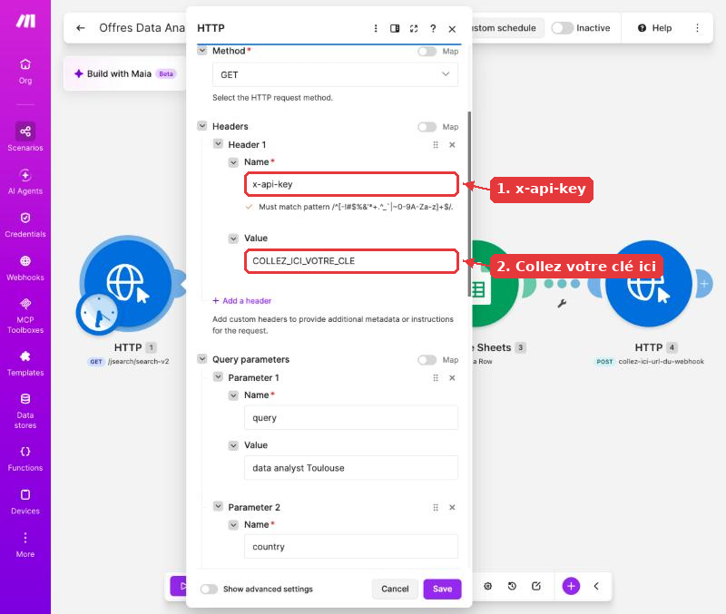

Dans **Query parameters**, ajoutez vos critères avec **« + Add a parameter »** :

- **`query`** — Exemple de valeur : `data analyst Toulouse` — Rôle : Le métier et la ville, comme une recherche Google (essayez aussi `stage data analyst Toulouse` ou `alternance data analyst Toulouse`)
- **`country`** — Exemple de valeur : `fr` — Rôle : Offres en France
- **`language`** — Exemple de valeur : `fr` — Rôle : Offres en français
- **`date_posted`** — Exemple de valeur : `week` — Rôle : Offres des 7 derniers jours (autres valeurs : `today`, `3days`, `month`, `all`)
- **`num_pages`** — Exemple de valeur : `1` — Rôle : Une page de résultats, soit environ 10 offres

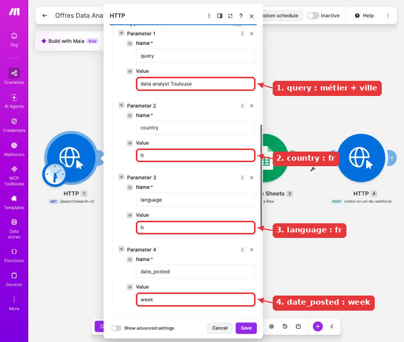

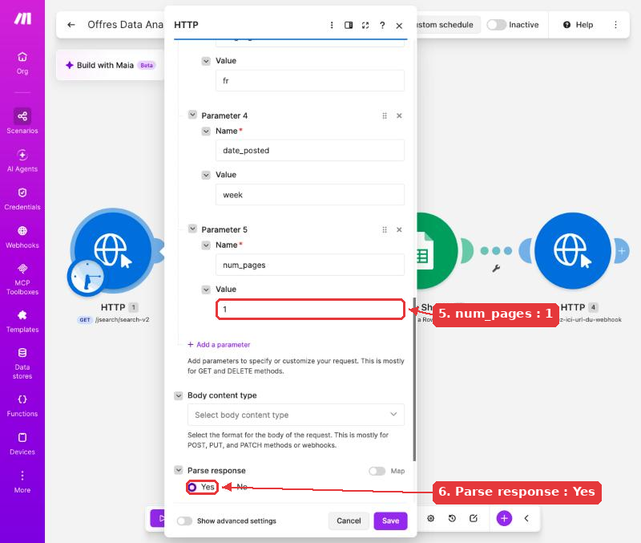

> ⚠️ Ne touchez jamais à la touche **Échap** dans un panneau de module : elle le ferme sans enregistrer. Cliquez sur **Save** en bas du panneau.

### Tester le module

Faites un **clic droit** sur le module HTTP, puis **« Run this module only »** : une seule requête JSearch est consommée. Ouvrez la bulle qui apparaît au-dessus du module : un **Status Code 200** signifie que tout va bien. Dépliez **Data**, puis **data** : `jobs` contient les offres.

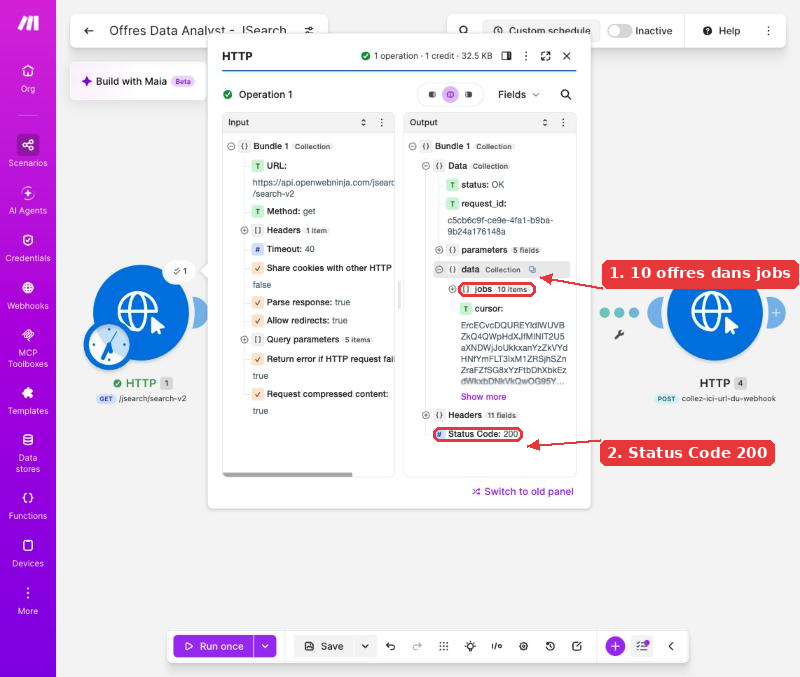

Chaque offre est un **bundle** (en Python, un dictionnaire). Repérez les champs utiles pour votre Sheet :

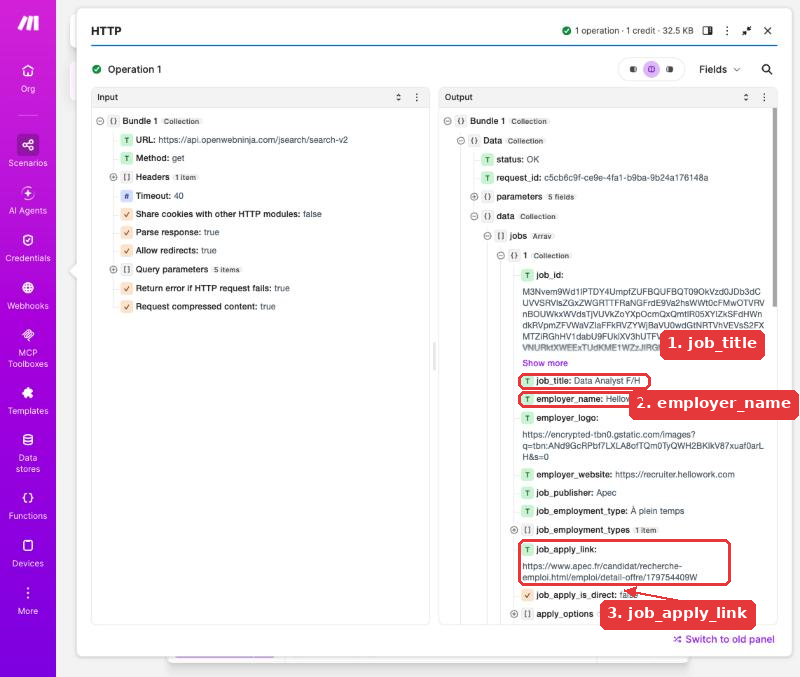

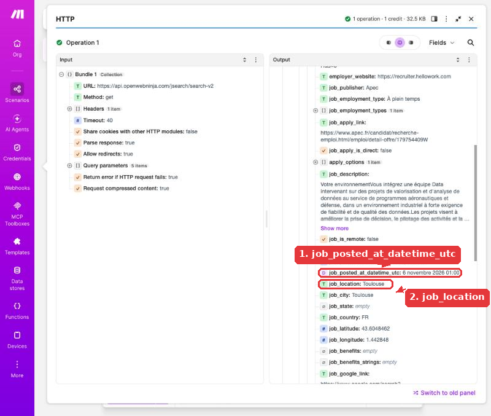

- **401 ou 403** : Clé absente ou mal collée (espace en trop, clé incomplète) ou header mal nommé : il faut exactement `x-api-key`
- **429** : Quota dépassé (200 requêtes par mois sur l'offre gratuite) : attendez le mois suivant
- **`jobs` vide** : Aucune offre pour votre recherche : élargissez la ville, les mots-clés ou `date_posted`

### Dernier module — L'alerte Discord

Après le module Google Sheets, ajoutez un deuxième **HTTP > Make a request** :

- **Authentication type** : `No authentication`
- **URL** : l'URL de votre webhook Discord
- **Method** : `POST`
- **Body content type** : `multipart/form-data`
- **Field 1** : Name `content`, Field type `Text`, Value = votre message

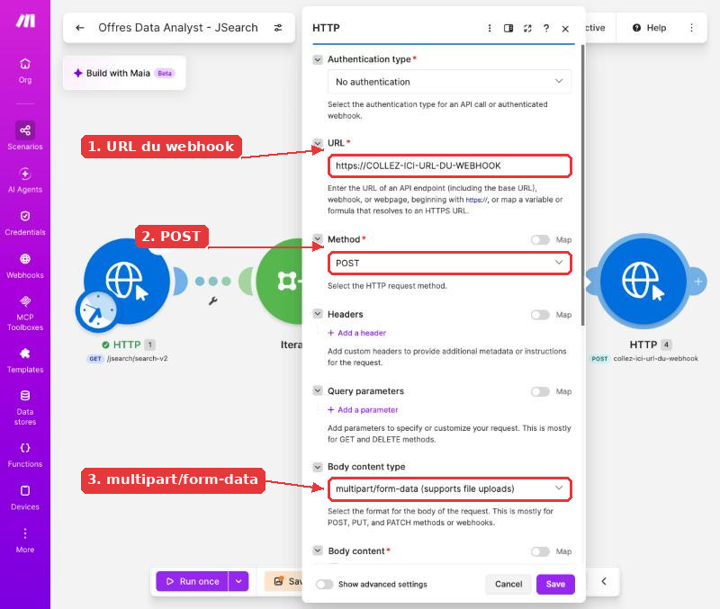

> ⚠️ Envoyer une dizaine de messages d'affilée peut déclencher une erreur **429** (trop de messages d'un coup). Si cela arrive, ajoutez entre Google Sheets et Discord un module **Tools > Sleep** réglé sur **1** seconde. Il consomme un crédit par offre : comptez-le dans votre estimation.

À vous de composer le message avec les pastilles de l'offre (intitulé, entreprise, lieu, contrat, lien). Astuce : dans Discord, un texte entouré de `**` s'affiche en gras.

## Bonus — Ne plus ajouter de doublons

À faire **uniquement quand la première version fonctionne** (Sheet rempli, alertes Discord reçues, scénario planifié).

**Le problème.** Si le scénario tourne deux fois dans la même semaine (un Run once de test, une démo, une planification modifiée), les mêmes offres sont ajoutées une deuxième fois dans le Sheet et vous recevez de nouveau les mêmes alertes.

**L'idée.** Avant d'ajouter une offre, Make **regarde ce qui existe déjà dans le Google Sheet** : si l'offre y est déjà, on ne l'ajoute pas et on n'envoie pas d'alerte. En Python, ce serait `if offre not in deja_vues: ajouter(offre)`.

1. Faites un **clic droit sur la liaison** (les petits points) entre l'Iterator et **Add a Row**, puis **Add module** > **Google Sheets** > **Search Rows**.
2. Réglez-le sur le **même Sheet** et le **même onglet** que Add a Row, **Table contains headers** : `Yes`.
3. Dans **Filter**, choisissez la colonne **Lien de l'offre (G)**, l'opérateur **Text operators: Equal to**, et cliquez la pastille **`job_apply_link`** de l'offre en cours (sous l'Iterator). Mettez **Limit** à `1` : une seule ligne trouvée suffit pour savoir que l'offre existe.
4. Cliquez sur la **liaison** entre Search Rows et Add a Row pour créer un **filtre** nommé `Offre absente du Sheet`, avec la condition : pastille **Total number of bundles** de Search Rows, opérateur **Numeric operators: Equal to**, valeur `0`.
5. Sauvegardez, puis testez : lancez **Run once** deux fois de suite. Au deuxième passage, le filtre doit laisser passer **0** offre : aucune nouvelle ligne, aucune alerte.

> 💡 Pourquoi « Total number of bundles = 0 » ? Search Rows renvoie toujours un résultat, même quand il ne trouve rien : il indique alors **0** dans *Total number of bundles*. C'est ce nombre que le filtre teste. Chaque vérification consomme 1 crédit Make par offre (mais aucune requête JSearch en plus) : comptez-le dans votre estimation.

Questions guidantes : pourquoi chercher sur le lien de l'offre plutôt que sur l'intitulé ? Combien de crédits Make ce bonus ajoute-t-il par exécution ?

## Livrables attendus

Un **dépôt GitHub public** nommé `recherche-emploi-make-<prénom>`, dans lequel les fichiers sont déposés directement (pas de fichier .zip). Il contient :

- un **document Word (.docx, possible depuis Google Docs) ou texte (.txt)** qui présente le projet : objectif, outils utilisés (Make, API JSearch, Google Sheets, Discord), rôle de chaque module du scénario, critères de recherche choisis (mots-clés, ville, période), estimation des crédits Make et des requêtes JSearch consommés par mois, difficultés rencontrées et solutions trouvées, lien du Google Sheet en lecture seule ;
- le **blueprint JSON** du scénario (menu « … » en haut à droite du scénario > Export Blueprint). Attention : ce fichier contient vos valeurs en clair. Ouvrez-le avec un éditeur de texte et remplacez la clé d'API et l'URL du webhook par `***` avant de le déposer ;
- les **captures d'écran** : le scénario complet, le Sheet rempli, le salon Discord avec les alertes et la planification, toutes **masquées** (clé, webhook, données personnelles).

## Modalités d'évaluation

- **Démo individuelle de 5 minutes**, lors d'une séance de restitution dédiée (en dehors des 7 h de réalisation) : lancement du scénario en direct (Run once), puis visite du Sheet et du salon Discord.
- **3 minutes de questions** : rôle de chaque module, à quoi sert le header `x-api-key`, ce qui se passerait sans `ifempty`, comment chercher dans une autre ville ou un seul type de contrat.

Une compétence est validée quand **100 % de ses critères** sont atteints.

## Critères de performance

**C6 — Collecter**

- Le module HTTP renvoie des offres réelles (Status Code 200, liste `jobs` non vide).
- La recherche est ciblée sur le métier, la ville et la semaine écoulée (`query`, `country`, `date_posted`).
- Le scénario est planifié une fois par semaine.
- L'apprenant explique pourquoi la clé passe dans un header et pourquoi elle doit rester secrète.

**C7 — Nettoyer et préparer**

- Les dates sont au format JJ/MM/AAAA.
- Aucune cellule vide pour l'entreprise et le lieu : une valeur par défaut est utilisée.
- Chaque offre indique son type de contrat et son site d'origine.
- Chaque offre a un lien cliquable qui ouvre la bonne annonce.

**C8 — Stocker**

- Le Sheet a une ligne d'en-têtes et une ligne par offre, sans décalage de colonnes.
- Les colonnes de suivi (statut, date de candidature, notes) sont présentes, placées à droite des colonnes remplies par Make, et laissées vides par le scénario.

**Transverse**

- Une alerte Discord est envoyée pour chaque offre ajoutée.
- Dépôt GitHub complet : document de présentation, blueprint JSON et captures, déposés directement (sans .zip).
- Aucune clé d'API ni URL de webhook visible dans le document, le blueprint ou les captures.

## Ressources

- [Tuto 1 — Connecter Google Sheets à Make](https://github.com/gsoulat/brief-recherche-emploi-make/blob/main/ressources/tuto-1-connecter-google-sheets-a-make.pdf)
- [Tuto 2 — Construire la veille RSS dans Make](https://github.com/gsoulat/brief-recherche-emploi-make/blob/main/ressources/tuto-2-construire-la-veille-rss-dans-make.pdf)
- [OpenWeb Ninja — JSearch API](https://www.openwebninja.com/api/jsearch) : création du compte, offre gratuite et documentation
- [Make — documentation de l'app HTTP](https://apps.make.com/http)
- [Discord — Intro to Webhooks](https://support.discord.com/hc/en-us/articles/228383668-Intro-to-Webhooks)
